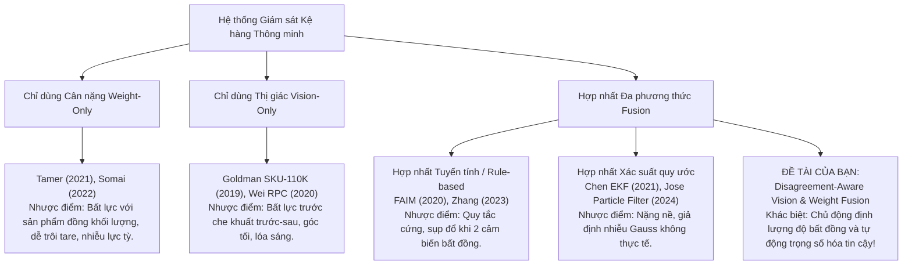

# Bảng Tổng Quan Tài Liệu Nghiên Cứu (Literature Matrix)

> **Dự án**: Disagreement-Aware Vision and Weight Sensor Fusion for AIoT Smart Shelf Inventory Monitoring  
> **Cập nhật lần cuối**: 2026-10-21  
> **Tài liệu tham khảo Zotero**: [`docs/literature/smart_shelf_library.bib`](file:///c:/Users/ADMIN/Documents/Disagreement-Aware%20Vision%20and%20Weight%20Sensor%20Fusion%20for%20AIoT%20Smart%20Shelf%20Inventory%20Monitoring/docs/literature/smart_shelf_library.bib) | [`docs/literature/smart_shelf_library.ris`](file:///c:/Users/ADMIN/Documents/Disagreement-Aware%20Vision%20and%20Weight%20Sensor%20Fusion%20for%20AIoT%20Smart%20Shelf%20Inventory%20Monitoring/docs/literature/smart_shelf_library.ris)

---

## 1. Ma Trận Nghiên Cứu (Literature Matrix)

| STT | Paper (Tác giả, Năm, Tạp chí/Hội nghị) | Phương pháp (Methodology / Fusion Approach) | Cảm biến sử dụng (Sensors) | Dataset / Quy mô thực nghiệm | Metric đánh giá | Khoảng trống nghiên cứu (Research Gap) |
| :---: | :--- | :--- | :--- | :--- | :--- | :--- |
| **1** | **FAIM** (Falcão et al., 2020) — *Frontiers in Built Environment* | Hợp nhất đa phương thức cấp quyết định dựa trên mô hình đồ thị xác suất (Graphical Model), State Machine và bản đồ bố trí kệ hàng (Floorplan Prior). | Camera RGB góc rộng gắn trần/kệ + Cảm biến lực (Load cell) tích hợp dưới từng ngăn kệ. | Môi trường cửa hàng thực nghiệm mini với 10 loại SKU, hàng trăm lượt tương tác lấy/trả hàng. | - Event Detection Accuracy (92–96%) - Product Identification Accuracy - False Positive Rate | Giả định người mua tương tác đơn lẻ, có bản đồ vị trí SKU cố định. Thất bại khi xảy ra che khuất kéo dài hoặc tráo đổi vị trí giữa các mặt hàng có cùng trọng lượng. Không định lượng mức độ bất đồng (disagreement) giữa camera và cân. |
| **2** | **Jose et al. (2024)** — *MDPI Sensors* | Theo dõi hành vi khách hàng bằng Faster R-CNN + StrongSORT; lọc hạt thích nghi kết hợp RANSAC (PACK-RMPF) để map tọa độ tay với độ sụt cân nặng. | Camera RGB trần + Mảng 12 cặp load cell (Strain gauge) gắn dưới các phân vùng kệ. | Kệ siêu thị mô phỏng trong phòng lab, 5 SKU nước đóng chai/hộp, kịch bản với hành vi nhặt chéo vùng (cross-location). | - MOTA, MOTP (Tracking) - Weight precision (±2g) - Action Recognition Rate (>90%) | Khối lượng tính toán rất nặng (R-CNN + Particle Filter + RANSAC), khó chạy real-time trên vi điều khiển AIoT biên (ESP32/Edge TPUs). Tập trung vào hành vi người mua thay vì tự động kiểm kê số lượng tồn kho khi bị che khuất tầng sâu. |
| **3** | **Tamer & Koklu (2021)** — *IJIRSS* | Hệ thống đếm thuần trọng lượng (Weight-only): Hiệu chuẩn ma trận 4 load cell, tính tổng khối lượng chia cho khối lượng đơn vị danh định theo ngưỡng cứng. | 4 x Load cell (Cầu Wheatstone) + Module biến đổi ADC 24-bit HX711 + Vi điều khiển. | Bàn thí nghiệm với các mặt hàng đóng hộp và chai nước ngọt bán lẻ tiêu chuẩn. | - Đồ thị sai số đo lường (sai số < 5g) - Độ chính xác đếm số lượng (98% ở trạng thái tĩnh). | **Chỉ dùng cảm biến cân nặng:** Hoàn toàn bất lực khi phân biệt các sản phẩm có cùng trọng lượng (ví dụ: lon Coca 330ml vs Pepsi 330ml). Dễ bị tác động bởi lực tỳ đè của tay người, rung chấn cơ học hoặc trôi điểm Zero (Tare drift). |
| **4** | **Somai et al. (2022)** — *IEEE Conf.* | Kiến trúc phần cứng vi vi xử lý IoT: Thu thập dữ liệu lực từ TAL220 + HX711 kép truyền qua Wi-Fi bằng ESP32 DevKitC về máy chủ MySQL/PHP. | Cảm biến lực TAL220 + Mạch khuếch đại kép HX711 + ESP32 Wi-Fi. | Mô hình kệ tải trọng tối đa 5kg với các bước nhảy trọng lượng rời rạc. | - Độ trễ truyền gói tin (<200ms) - Độ phân giải đo (1g) - Tốc độ gửi bản tin telemetry | Hệ thống thuần viễn thám đo lường (Telemetry), không có tầng xử lý thị giác máy tính và không có thuật toán AI phân loại. Phải cấu hình cứng khối lượng sản phẩm cho từng ngăn. |
| **5** | **Goldman et al. (2019)** — *IEEE/CVF CVPR* | Xây dựng bộ dữ liệu benchmark SKU-110K và mạng phát hiện đối tượng EM-Merger chuyên biệt cho kệ hàng bán lẻ mật độ cực dày. | Camera RGB phân giải cao (Thị giác đơn phương thức). | Bộ dữ liệu **SKU-110K** gồm hơn 11.000 ảnh chụp siêu thị thực tế với hơn 1,7 triệu bounding box mật độ dày. | - mAP@0.5, mAP@0.75 - Tỷ lệ trùng lặp IoU - Mean Absolute Error (MAE) | **Chỉ dùng thị giác:** Khi hàng hóa bị xếp chồng lớp (sản phẩm phía trước che khuất hoàn toàn sản phẩm phía sau), Camera quang học về mặt vật lý không thể nhìn thấy hàng phía sau $\rightarrow$ Tỷ lệ đếm thiếu (false negative) tăng vọt. |
| **6** | **Liu et al. (2022)** — *IEEE TNNLS* | Hợp nhất đa cảm biến nhận biết bất đồng dựa trên Lý thuyết Bằng chứng Dempster-Shafer (DST) và Evidential Deep Learning (Subjective Logic). | Thị giác máy tính + Cảm biến lực/quán tính (Vision + Force/IMU). | Bộ dữ liệu đa phương thức tổng hợp và môi trường robot tiếp xúc vật lý dưới điều kiện nhiễu cố ý. | - Conflict Mass Metric ($K$) - Robust Accuracy under Sensor Corruption - Brier Score, ECE (Calibration) | Thuật toán xây dựng cho bài toán nhận dạng trạng thái robot/xe tự hành liên tục; chưa được tối ưu hóa cho bài toán kiểm kê số lượng rời rạc ($N \in \mathbb{N}$) và phần cứng AIoT nhúng siêu nhẹ. |
| **7** | **Chen et al. (2021)** — *IEEE Internet of Things Journal* | Hợp nhất cảm biến bằng Bộ lọc Kalman Mở rộng thích nghi (Adaptive EKF) kết hợp cân điện tử và cảm biến quang học Time-of-Flight (ToF). | Cảm biến tải trọng (Load cell) + Cảm biến đo khoảng cách ToF + Camera RGB phụ trợ. | Tủ bán hàng thông minh (Smart Vending Cabinet) với 12 mặt hàng đồ uống đóng chai. | - Sai số đếm số lượng (MAE < 0.2) - Độ trễ cập nhật trạng thái (< 500ms) | Bộ lọc Kalman giả định nhiễu phân phối chuẩn (Gaussian noise). Khi camera gặp che khuất đột ngột hoặc góc chết (lỗi phi Gauss cực lớn), EKF có xu hướng bị lệch nghiệm và kéo sai kết quả hợp nhất. |
| **8** | **Wei et al. (2020)** — *IEEE TPAMI* | Thiết lập bộ dữ liệu chuẩn RPC (Retail Product Checkout) và khảo sát giới hạn của các mô hình Single-shot / Two-stage Detectors trong môi trường xếp lộn xộn. | Hệ thống đa camera RGB từ nhiều góc chụp (Top, Side, Front). | Bộ dữ liệu RPC: 200 danh mục sản phẩm bán lẻ, 53.000 ảnh từ kịch bản đơn lẻ đến kịch bản che khuất nặng (Cluttered). | - Check-out Accuracy (cAcc) - Mean Categorization Error (mCE) - Mean Counting Error (mCD) | Chứng minh ranh giới hạn chế của thị giác: Dù dùng nhiều camera bao quanh, trong tình huống hàng hóa bị che khuất sâu, tỷ lệ nhận dạng sai và đếm thiếu vẫn dao động từ 15–28% nếu không có cảm biến vật lý bù trừ. |
| **9** | **Zhang et al. (2023)** — *ACM Trans. Sensor Networks* | Phân bổ tính toán biên (Edge Computing): ESP32 phụ trách đọc cảm biến trọng lượng tần số cao, Gateway Jetson Nano chạy model thị giác nén. | Cảm biến tải trọng + Camera USB RGB + Node ESP32 + Edge Gateway Jetson Nano. | Kệ hàng siêu thị quy mô 4 tầng, thử nghiệm chu kỳ đọc liên tục trong 30 ngày. | - Điện năng tiêu thụ (Watt) - Băng thông mạng (Kbps) - End-to-end Inference Latency | Chiến lược hợp nhất còn thô sơ (Naive Rule-based: ưu tiên Camera trước, nếu mờ thì chuyển sang cân). Chưa có cơ chế giải quyết mâu thuẫn khi 2 cảm biến đưa ra 2 kết quả đối nghịch nhau. |
| **10** | **Wang et al. (2023)** — *IEEE Survey / Edge AI* | Khảo sát và tối ưu hóa các kiến trúc YOLO thế hệ mới (YOLOv8n/s) trên vi xử lý biên nhúng phục vụ nhận diện vật thể bán lẻ trong điều kiện che khuất. | Camera RGB gắn trực tiếp mặt trước kệ hàng (Front-facing camera). | Tập dữ liệu bán lẻ tổng hợp (chai lọ, lon nước ngọt, bánh kẹo). | - mAP@0.5:0.95 - Inference FPS trên CPU/Edge GPU - Brier Confidence Calibration Score | Mô hình thị giác chỉ cung cấp độ tin cậy nội tại (Bounding Box Confidence Score), không biết được môi trường vật lý bên ngoài (ví dụ: kệ có đang bị rung, có đồ vật vô hình đè lên không). |

---

## 2. Phân Tích Tổng Hợp & Định Vị Đóng Góp Của Đề Tài (Taxonomy & Research Gap)

### 2.1. Phân loại các tiếp cận trong tài liệu hiện có

### 2.2. Bảng Phân Tích Tình Huống Bất Đồng Cảm Biến (Sensor Disagreement Scenarios)

Trong thực tế vận hành kệ hàng thông minh AIoT, hai cảm biến thường xuyên rơi vào trạng thái bất đồng (Disagreement):

| Tình huống thực tế | Trạng thái Thị giác (Vision - YOLO) | Trạng thái Cảm biến Cân (Weight - Load Cell) | Bản chất mâu thuẫn | Giải pháp thông thường (Tài liệu cũ) | Giải pháp của Đề tài này (**Disagreement-Aware**) |
| :--- | :--- | :--- | :--- | :--- | :--- |
| **Che khuất tầng sâu (Occlusion)** | Thấy 2 chai (do chai sau bị che hoàn toàn) $\rightarrow N_V = 2$ | Cân đo được 1320g (tương đương 4 chai 330g) $\rightarrow N_W = 4$ | Vision bị che khuất, Weight đo chính xác. | Thường lấy trung bình hoặc tin tưởng Vision $\rightarrow$ Sai số tồn kho. | Nhận diện độ bất đồng cao, kiểm tra mức độ che khuất (Bounding box overlap) $\rightarrow$ **Giảm trọng số Vision, tin cậy Weight**. |
| **Khách hàng tỳ tay / Rung chấn kệ** | Thấy 3 chai rõ ràng, không che khuất $\rightarrow N_V = 3$ | Cân đột ngột nhảy lên 2500g (do lực đè bên ngoài) $\rightarrow N_W = 7$ | Lực ngoại cảnh giả mạo trọng lượng; Vision chính xác. | Cân báo có thêm hàng mới (False Positive). | Nhận diện xung lực đột biến (Spike filter) + Vision tự tin cao $\rightarrow$ **Ưu tiên Vision, lọc bỏ xung trọng lượng**. |
| **Tráo đổi SKU cùng trọng lượng** | Thấy lon Sprite màu xanh $\rightarrow \text{SKU} = \text{Sprite}$ | Cân chỉ xác nhận có 330g (không biết nhãn hiệu gì) | Weight thiếu tính ngữ nghĩa (Semantics). | Cân gán nhầm theo planogram cũ. | **Vision gán nhãn SKU, Weight xác thực số lượng** thông qua ma trận tương quan danh mục. |
| **Ánh sáng yếu / Chói đèn LED** | Độ tin cậy bbox tụt sâu ($conf < 0.3$) $\rightarrow N_V = 0$ | Cân ổn định 990g $\rightarrow N_W = 3$ | Thị giác bị suy giảm chất lượng do môi trường. | Model dự đoán kệ hết hàng (Stockout ảo). | Phân tích entropy ảnh & ánh sáng $\rightarrow$ **Tự động chuyển sang chế độ Weight-Dominant**. |

---

## 3. Hướng Dẫn Import Thư Viện Vào Zotero Trên Máy Tính

Toàn bộ 10 bài báo khoa học chuẩn IEEE/ACM/MDPI/Frontiers đã được biên soạn đầy đủ metadata, DOI, Abstract và đường link trực tiếp đến các file PDF sẵn có trong máy tính của bạn tại:

- **File BibTeX**: [`docs/literature/smart_shelf_library.bib`](file:///c:/Users/ADMIN/Documents/Disagreement-Aware%20Vision%20and%20Weight%20Sensor%20Fusion%20for%20AIoT%20Smart%20Shelf%20Inventory%20Monitoring/docs/literature/smart_shelf_library.bib)
- **File RIS**: [`docs/literature/smart_shelf_library.ris`](file:///c:/Users/ADMIN/Documents/Disagreement-Aware%20Vision%20and%20Weight%20Sensor%20Fusion%20for%20AIoT%20Smart%20Shelf%20Inventory%20Monitoring/docs/literature/smart_shelf_library.ris)

### Các bước nhập vào Zotero (1-Click)

1. Mở phần mềm **Zotero** trên máy tính của bạn (`C:\Program Files\Zotero\zotero.exe`).
2. Trên thanh menu, chọn **File** $\rightarrow$ **Import...** (hoặc nhấn `Ctrl + Shift + I`).
3. Chọn tùy chọn **A file (BibTeX, RIS, Zotero RDF, etc.)** rồi nhấn **Next**.
4. Trỏ đến đường dẫn:  
   `C:\Users\ADMIN\Documents\Disagreement-Aware Vision and Weight Sensor Fusion for AIoT Smart Shelf Inventory Monitoring\docs\literature\smart_shelf_library.bib`
5. Nhấn **Open**, chọn *Place imported collections and items into a new collection* $\rightarrow$ **Next** $\rightarrow$ **Finish**.
6. **Kết quả**: Toàn bộ thư viện bài báo tham khảo chuẩn quốc tế kèm tóm tắt và file PDF đính kèm sẽ hiển thị ngay trong Zotero của bạn!
